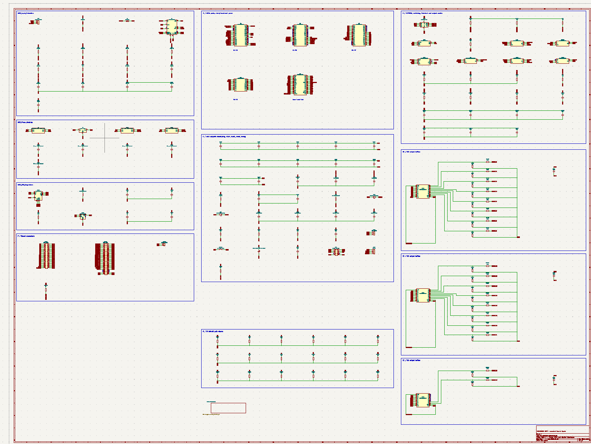
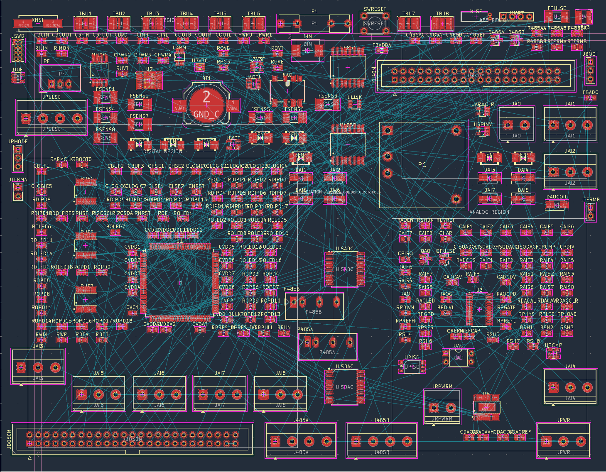

这两张图是 ChatGPT 生成的电气原理图和 PCB 布局尝试。

现在看起来并不专业，也不正确。器件选型、网络连接、层次划分、封装摆放和布线规则都不能直接用于实际项目。它更像是一张把想法快速可视化的草图，而不是可以交付的工程图纸。

*ChatGPT 生成的电气原理图尝试。*

*ChatGPT 生成的 PCB 布局尝试。*

不过，这种尝试依然值得记录。今天它还无法替代工程师完成真正的电路设计，但随着模型对器件手册、设计规则和 EDA 工具的理解不断增强，未来肯定会做得更好。
