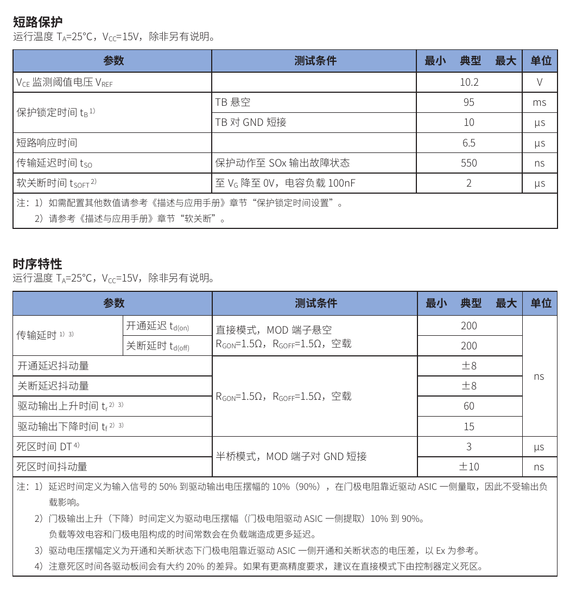
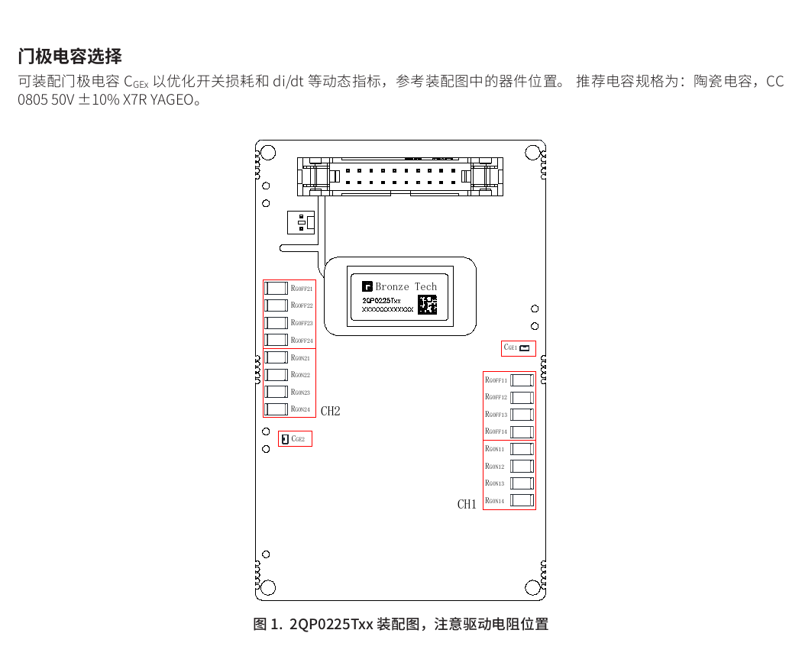

2QP0225Txx 是青铜剑推出的一款双通道紧凑型即插即用 IGBT 门极驱动器，基于第二代 ASIC 芯片组，主要配合 1700V 及以下的 EconoDual 封装 IGBT 模块构成半桥。驱动板可以直接焊接在功率模块上，不需要额外转接板，适合储能变流器、风电变流器和光伏逆变器等设备。

手册版本为 V1.2，修订日期为 2024 年 5 月 30 日。下面按实际选型和调试时最常用的内容进行整理。

## 主要参数

| 项目 | 参数 |
|---|---:|
| 原边供电 | 15V，允许范围 14.5～15.5V |
| 门极驱动电压 | +15V / -10V |
| 单通道峰值驱动电流 | ±25A |
| 单通道驱动功率 | 85℃时 2W，70℃时 2.4W |
| 最高开关频率 | 200kHz |
| 工作温度 | -40℃～85℃ |
| 原边绝缘耐压 | 5000Vac，50Hz、1s |
| 副边绝缘耐压 | 4000Vac，50Hz、1s |
| 原边与副边耦合电容 | 14pF |

2QP0225T12xx 面向 1200V 等级 IGBT，手册给出的直流母线电压上限为 800V；2QP0225T17xx 面向 1700V 等级 IGBT，直流母线电压上限为 1200V。这里的 T12、T17 不只是型号名称差异，还对应运行电压和有源钳位阈值的不同。

驱动器支持直接模式和半桥模式。直接模式下两个通道由控制器独立控制；半桥模式下驱动器内部加入约 3μs 死区。对于死区精度要求较高的应用，手册建议使用直接模式，由主控制器生成死区，因为不同驱动板之间的内部死区可能存在约 20% 的差异。

## 集成的保护功能

2QP0225Txx 集成了原边和副边供电欠压、IGBT 短路保护、有源钳位和软关断。对高功率 IGBT 来说，这几项功能决定了故障时能否把集电极过压和短路能量控制在安全范围内。

短路保护采用 VCE 监测，典型阈值为 10.2V，典型短路响应时间为 6.5μs。保护动作后，驱动器通过软关断把门极电压降至 0V；在 100nF 等效电容负载下，典型软关断时间为 2μs。故障状态传递到 SOx 输出的典型延迟为 550ns。

*图 1：手册给出的短路保护和时序特性。*

保护锁定时间由 TB 端设置：TB 悬空时典型值为 95ms，TB 对 GND 短接时为 10μs。实际设计中需要根据系统故障处理逻辑选择锁定时间，避免控制器尚未完成故障确认，驱动器就重新允许开通。

欠压保护同时监控三处电源：

- 原边 15V 供电跌至约 12.5V 时触发，恢复阈值约 13.5V；
- 副边正电源相对发射极跌至约 12V 时触发；
- 副边负电源幅值跌至约 4.4V 时触发。

正负门极电源都被监控，可以降低启动、掉电或隔离电源异常时 IGBT 处于线性区的风险。

## 传播延迟与开关速度

在直接模式、RGON 和 RGOFF 均为 1.5Ω、空载条件下，开通和关断传播延迟典型值均为 200ns，延迟抖动为 ±8ns。驱动输出上升时间为 60ns，下降时间为 15ns。

这些数字是在门极电阻靠近驱动 ASIC 一侧测得的。接入真实 IGBT 后，门极电荷、外部电阻、驱动回路电感和米勒平台都会增加实际开关时间，因此不能直接把 60ns 或 15ns 当作功率器件的开关时间。

## 绝缘与抗扰度

驱动器的原边-副边电气间隙为 12mm、爬电距离为 13.2mm；两个副边通道之间的电气间隙和爬电距离均为 8.8mm。相关距离按 IEC 61800-5-1 设计。

手册给出的抗扰度包括：

- IEC 61000-4-2 接触放电 ±4kV、空气放电 ±8kV；
- IEC 61000-4-4 电快速瞬变脉冲群 ±4kV；
- IEC 61000-4-9 脉冲磁场抗扰度 ±2000A/m。

这些指标能够反映驱动板本身的绝缘与抗扰能力，但整机仍要结合母排结构、共模电流路径、屏蔽接地和控制板接口重新进行 EMC 验证。

## 型号后缀怎么区分

型号中的 A0 和 C0 对应不同的逻辑输入电平：

| 类型 | 开通阈值 | 关断阈值 | 典型接口 |
|---|---:|---:|---|
| A0 | 2.4V | 1.7V | 5V 逻辑输入 |
| C0 | 9.1V | 6.5V | 15V 逻辑输入 |

C0 型号的 SOx 状态输出配置 10kΩ 上拉电阻。带 Q 编号的定制型号还会预装不同的门极电阻、门极电容和三防漆。1200V 型号有源钳位典型阈值为 1020V，1700V 型号为 1560V。

选型时不能只看 T12 或 T17，还要同时确认控制器输出电平、状态信号接口、预装门极器件、有源钳位电压以及是否需要三防漆。

## 门极电阻的配置方法

每个通道的开通电阻和关断电阻都由 4 只贴片电阻并联组成。手册推荐使用 2010、3/4W、±5% 电阻。因此，装配表中单只电阻的阻值并不是最终等效门极电阻。

例如 FF225R12ME4 对应的开通侧为 4 只 6.8Ω 并联，等效约 1.7Ω；关断侧为 4 只 10Ω 并联，等效约 2.5Ω。FF225R17ME4 的开通侧为 4 只 15Ω 并联，等效约 3.8Ω；关断侧为 4 只 33Ω 并联，等效约 8.3Ω。

*图 2：两个通道的 RGON、RGOFF 和 CGE 装配位置。*

手册中的推荐值适合作为调试起点，不能不经测试直接定版。实际电阻需要同时检查：

1. 开通和关断损耗；
2. VCE 过冲与门极振荡；
3. dv/dt、di/dt 对周边电路的影响；
4. 二极管反向恢复电流；
5. 短路关断时的母线过压；
6. 并联器件的动态均流。

驱动板还预留 CGE 门极电容，可通过 10nF 或 47nF 等配置调整开关损耗和 di/dt。手册推荐 0805、50V、±10%、X7R 陶瓷电容。增加 CGE 会降低开关速度，但也会提高驱动功耗，使用前需要校核 2W 单通道功率限制。

## 使用时需要注意的几个问题

- 上电前确认驱动板与控制板连接可靠，避免空接、虚接和虚焊；
- 驱动板安装后可能承受超过安全范围的对地电压，调试时不能徒手接触；
- 驱动器和 IGBT 都属于静电敏感器件，应按 ESD 要求操作；
- 门极回路应尽量短，开通与关断回路的公共电感要小；
- 首次双脉冲测试应从低母线电压和小电流开始，逐步观察 VGE、VCE 和 IC；
- 有源钳位、软关断和控制器封波逻辑应作为一个整体验证，不能分别确认后就认为系统保护成立。

## 小结

2QP0225Txx 把隔离电源、双通道门极输出、欠压、短路、有源钳位和软关断集成在一块可直接安装到 EconoDual 模块上的驱动板中，适合需要快速完成 1200V 或 1700V IGBT 半桥设计的项目。

它的即插即用主要解决机械匹配和基础保护问题，最终的开关性能仍然取决于门极器件配置、母排杂散电感、控制时序和故障关断测试。手册中的门极电阻表应当作为首轮样机的起点，而不是最终设计结论。
